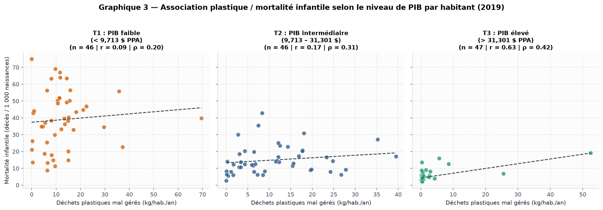

# Déchets plastiques mal gérés et mortalité infantile

**Projet de Python pour la data science — analyse descriptive de l’année 2019**  
**Groupe :** Anton Lucibello, Marius Pribetich et Rayan Goma

**Sujet validé par le chargé de TD.**

## Question de recherche

> En 2019, parmi les pays et territoires disposant des données, observe-t-on une association descriptive entre les déchets plastiques mal gérés par habitant et le taux de mortalité infantile ? Cette association paraît-elle similaire lorsqu’on compare séparément les groupes de PIB par habitant et d’accès à l’assainissement de base ?

L’analyse compare des indicateurs nationaux pour une seule année. Une association entre ces mesures ne démontre pas que les déchets plastiques causent une hausse de la mortalité infantile et ne permet pas de déduire le risque d’un enfant individuellement.

## Résultats

Dans l’extraction utilisée pour le notebook, 153 pays/territoires ont pu être appariés aux métadonnées de la Banque mondiale. Parmi eux, 151 disposent des données de déchets et de mortalité, et 139 ont des données complètes sur les quatre indicateurs. La corrélation de rang de Spearman déchets–mortalité affichée dans le notebook est d’environ **0,585** sur les 151 observations; Pearson est d’environ **0,337**. Les comparaisons par groupes de PIB et d’assainissement sont également affichées dans le notebook et montrent une association de force variable.

Ces statistiques décrivent l’extraction et les sorties actuellement enregistrées; les API peuvent être mises à jour. Le notebook calcule aussi une comparaison de Spearman entre l’échantillon déchets–mortalité et les cas complets. Exécuter le notebook après toute nouvelle collecte et vérifier les résultats avant de les présenter.

## Figures

Les figures sont des sorties descriptives enregistrées dans `outputs/figures/` :

**Distributions des quatre indicateurs**


**Déchets plastiques mal gérés et mortalité infantile**


**Comparaison descriptive par groupes de PIB**



**Comparaison descriptive par groupes d’assainissement**


## Données et variables

Le projet combine Our World in Data (OWID) et les indicateurs World Development Indicators (WDI) de la Banque mondiale.

| Variable utilisée | Source et code | Définition / unité |
|---|---|---|
| Déchets plastiques mal gérés par habitant | [OWID — source Meijer et al. (2021)](https://ourworldindata.org/grapher/mismanaged-plastic-waste-per-capita) | kg par personne et par an; estimation des déchets non recyclés, non incinérés ou non conservés dans des décharges étanches. Ne mesure pas directement l’exposition individuelle. |
| Mortalité infantile | World Bank WDI `SP.DYN.IMRT.IN` | Décès avant l’âge d’un an pour 1 000 naissances vivantes. |
| PIB par habitant | World Bank WDI `NY.GDP.PCAP.PP.KD` | Dollars internationaux constants de 2021 par habitant, en parité de pouvoir d’achat (PPA). |
| Assainissement de base | World Bank WDI `SH.STA.BASS.ZS` | Pourcentage de la population utilisant au moins un service d’assainissement de base; ne mesure pas la collecte des déchets solides. |

Les tables sont filtrées à 2019 et jointes par code ISO3 et année, pas par nom. Les agrégats régionaux ou mondiaux sont exclus selon les métadonnées géographiques de la Banque mondiale. Les valeurs manquantes ne sont ni remplacées par zéro ni imputées.

## Fichiers du dépôt

```text
.
├── README.md
├── requirements.txt
├── Notebook.ipynb       # analyse et graphiques
├── download.py          # collecte des sources et manifeste
├── cleaning.py          # nettoyage, jointure et exports locaux
├── main.py              # préparation des tables et résumé des effectifs
├── data/
│   ├── manifest.json    # créé par download.py; sources et empreintes
│   ├── raw/             # snapshots bruts locaux, ignorés par Git
│   └── cleaned/         # tables préparées localement, ignorées par Git
└── outputs/
    ├── figures/         # graphiques présentés ci-dessus
    └── tables/          # tableaux calculés localement, ignorés par Git
```

Les scripts et le notebook sont à la racine du dépôt. Ouvrir le notebook `Notebook.ipynb`; les chemins `src/` ou `notebooks/` ne sont pas utilisés dans cette version.

## Installation et exécution

Python **3.11** est recommandé. Depuis PowerShell, ouvrir un terminal à la racine du dépôt et lancer chaque commande dans l’ordre :

```powershell
py -3.11 -m venv .venv
.\.venv\Scripts\python.exe -m pip install --upgrade pip
.\.venv\Scripts\python.exe -m pip install -r requirements.txt
.\.venv\Scripts\python.exe download.py
.\.venv\Scripts\python.exe main.py
.\.venv\Scripts\python.exe -m jupyter lab
```

Les commandes créent un environnement isolé, installent les dépendances, téléchargent les sources absentes, préparent les tables puis ouvrent JupyterLab. Depuis JupyterLab, ouvrir `Notebook.ipynb`, redémarrer le noyau et choisir **Run All**. Le notebook doit être lancé depuis la racine du dépôt.

Sur macOS, Linux ou SSP Cloud, les commandes équivalentes sont :

```bash
python3.11 -m venv .venv
.venv/bin/python -m pip install --upgrade pip
.venv/bin/python -m pip install -r requirements.txt
.venv/bin/python download.py
.venv/bin/python main.py
.venv/bin/python -m jupyter lab
```

Les sources sont publiques; aucun compte GitHub, jeton d’API ou identifiant personnel n’est requis pour les télécharger.

## Données et reproductibilité

Les données brutes sont enregistrées localement dans `data/raw/`; les tables nettoyées et les tableaux calculés sont dans `data/cleaned/` et `outputs/tables/`. Ces répertoires sont ignorés par Git afin de ne pas publier les fichiers de données dans le dépôt. Le script `download.py` crée `data/manifest.json` avec les URLs utilisées, la taille et l’empreinte SHA-256 des fichiers; la date inscrite correspond à la création du manifeste, pas nécessairement à la date d’extraction initiale des snapshots déjà présents.

Sur un clone neuf, exécuter `python download.py` pour récupérer les fichiers absents. Le script conserve les snapshots déjà présents. Pour remplacer volontairement les données locales, utiliser :

```powershell
.\.venv\Scripts\python.exe download.py --force
```

Une nouvelle extraction peut changer les effectifs et les résultats. Après `--force`, relancer `main.py` et le notebook, puis vérifier les chiffres avant de les utiliser.

Pour reproduire **exactement** les résultats du snapshot initial, il faut obtenir les mêmes fichiers bruts et les copier dans `data/raw/` avant le téléchargement. Les consignes du cours recommandent de les partager hors Git, par exemple dans l’espace SSP Cloud/S3 du groupe. Le code actuel lit un dossier local ou monté; il ne lit pas directement une URL `s3://`. Le groupe doit suivre la procédure officielle du cours pour rendre les snapshots accessibles aux trois membres et au correcteur. Les anciennes copies locales restent sur la machine du groupe, mais un nouveau clone GitHub n’inclut pas ces fichiers. Les fichiers de données peuvent également rester présents dans les anciens commits publics; les changements de ce dépôt ne réécrivent pas l’historique.

## Méthode et limites

- Décrire les distributions et les données manquantes avec les effectifs, médianes et quartiles.
- Examiner le nuage de points déchets–mortalité, la corrélation de rang de Spearman et les valeurs extrêmes.
- Comparer la relation selon les terciles de PIB et des groupes d’assainissement, séparément, sur les cas complets.
- Les corrélations et comparaisons par groupes sont descriptives; elles n’éliminent pas les différences non observées entre pays.
- Cette coupe transversale de 2019 ne permet pas d’établir une causalité. Les déchets mal gérés ne mesurent pas l’exposition réelle des enfants, et l’assainissement ne mesure pas la gestion des plastiques.
- La disponibilité variable des indicateurs peut influencer les pays inclus dans chaque calcul.

## Références

- Our World in Data, [Mismanaged plastic waste per capita](https://ourworldindata.org/grapher/mismanaged-plastic-waste-per-capita), source Meijer et al. (2021), retraitée par OWID.
- World Bank WDI, [mortalité infantile `SP.DYN.IMRT.IN`](https://api.worldbank.org/v2/indicator/SP.DYN.IMRT.IN?format=json).
- World Bank WDI, [PIB/habitant `NY.GDP.PCAP.PP.KD`](https://api.worldbank.org/v2/indicator/NY.GDP.PCAP.PP.KD?format=json).
- World Bank WDI, [assainissement `SH.STA.BASS.ZS`](https://api.worldbank.org/v2/indicator/SH.STA.BASS.ZS?format=json).
- Cours « Python pour la data science », [page Évaluation](https://pythonds.linogaliana.fr/content/annexes/evaluation.html).

Vérifier les conditions de citation et licences des fournisseurs au moment du rendu.
