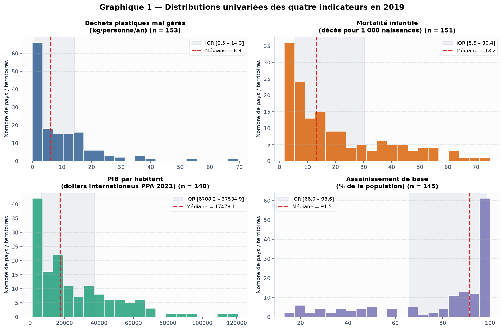
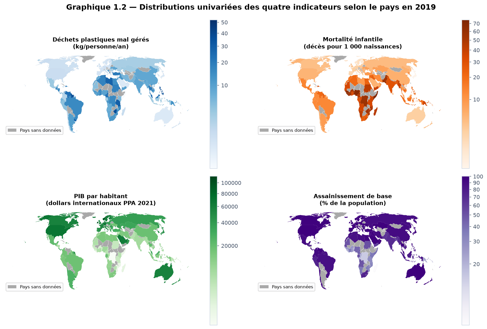
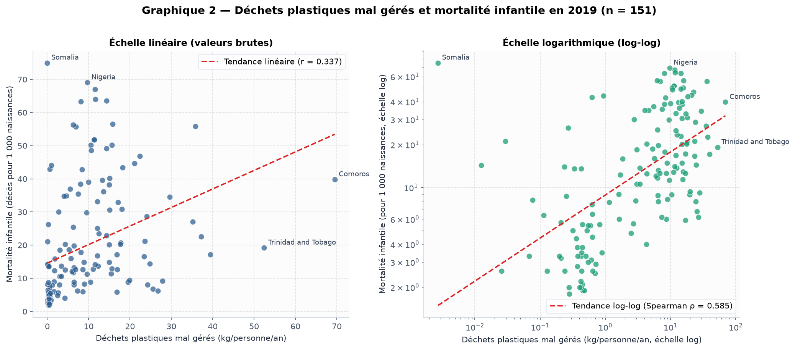
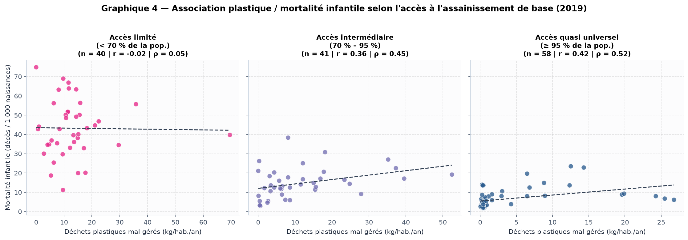

# Déchets plastiques mal gérés et mortalité infantile

**Projet de Python pour la data science — analyse descriptive, année 2019**

**Groupe :** Anton Lucibello, Marius Pribetich et Rayan Goma

**Sujet validé par le chargé de TD.**

## Problématique

> En 2019, parmi les pays et territoires disposant des données, observe-t-on une association descriptive entre les déchets plastiques mal gérés par habitant et le taux de mortalité infantile ? Cette association paraît-elle similaire lorsqu’on compare séparément les groupes de PIB par habitant et d’accès à l’assainissement de base ?

L’étude compare des indicateurs nationaux pour une année. Une association entre ces indicateurs ne démontre pas que les déchets plastiques causent une hausse de la mortalité infantile et ne permet pas d’en déduire l’exposition ou le risque d’un enfant individuellement.

## Contenu du dépôt

```text
.
├── Notebook.ipynb      # analyse descriptive, cartes et graphiques
├── download.py         # téléchargement des données sources
├── cleaning.py         # nettoyage, jointure et exports locaux
├── requirements.txt    # dépendances Python, dont GeoPandas
├── data/
│   ├── manifest.json   # provenance et empreintes des snapshots
│   └── raw data/       # CSV/JSON sources versionnés dans le dépôt (nom avec espace)
└── outputs/
    └── figures/        # figures exportées et versionnées
```

`main.py` n’est pas nécessaire : le parcours principal est le notebook `Notebook.ipynb`, qui appelle les fonctions de `cleaning.py` et `download.py`. Les tables générées dans `data/cleaned/` et `outputs/tables/` sont locales et ignorées par Git.

## Données et sources

Le projet croise quatre indicateurs de 2019 :

| Variable | Source et code | Définition / unité |
|---|---|---|
| Déchets plastiques mal gérés par habitant | [Our World in Data, source Meijer et al. (2021)](https://ourworldindata.org/grapher/mismanaged-plastic-waste-per-capita) | kg par personne et par an; estimation des déchets non recyclés, non incinérés ou non conservés dans des décharges étanches. Ce n’est pas une mesure directe de l’exposition individuelle. |
| Mortalité infantile | Banque mondiale WDI `SP.DYN.IMRT.IN` | Décès avant l’âge d’un an pour 1 000 naissances vivantes. |
| PIB par habitant | Banque mondiale WDI `NY.GDP.PCAP.PP.KD` | Dollars internationaux constants de 2021 par habitant, en PPA. |
| Assainissement de base | Banque mondiale WDI `SH.STA.BASS.ZS` | Pourcentage de la population utilisant au moins un service d’assainissement de base; ne mesure pas la collecte des déchets plastiques. |

Les données sont reliées par code géographique ISO3 et année, pas par nom. Les agrégats sont filtrés grâce aux métadonnées géographiques de la Banque mondiale. Les valeurs manquantes ne sont pas remplacées par zéro et ne sont pas imputées.

Les snapshots sources nécessaires à l’analyse sont présents sous **`data/raw data/`** (avec un espace dans le nom du dossier) et sont versionnés dans ce dépôt. L’archive géographique Natural Earth est également téléchargée dans ce dossier par le script; la cellule cartographique lit actuellement le fond depuis son URL publique. Le manifeste `data/manifest.json` documente les URL, tailles et empreintes des snapshots répertoriés. Les tables nettoyées sont recréées localement par le notebook et `cleaning.py`.

## Résultats descriptifs

Pour l’extraction enregistrée dans ce dépôt, 153 entités sont appariables, 151 disposent des valeurs de déchets et de mortalité, et 139 ont les quatre indicateurs. Dans l’échantillon principal, la corrélation de rang de Spearman est d’environ **0,585** et Pearson d’environ **0,337**. Les comparaisons par groupes de PIB et d’assainissement sont descriptives; la force de l’association varie entre groupes.

Ces chiffres décrivent l’extraction versionnée. Les sources peuvent être révisées. Après toute mise à jour, relancer le notebook et vérifier les sorties avant de reprendre les chiffres dans une présentation.

### Figures disponibles










La cellule cartographique du notebook utilise GeoPandas et lit le fond cartographique Natural Earth depuis une URL. Pour régénérer cette carte, installer les dépendances et disposer d’un accès réseau. Le groupe doit terminer la vérification complète de cette cellule avant d’affirmer que le notebook passe **Run All** dans un environnement propre.

## Installation et exécution avec VS Code (Windows)

1. Cloner le dépôt et ouvrir son dossier racine dans VS Code.
2. Installer l’extension Microsoft **Python** si nécessaire.
3. Choisir **Ctrl+Shift+P → Python: Select Interpreter** et sélectionner un interpréteur Python installé (Python 3.11 ou plus récent est recommandé).
4. Ouvrir **Terminal → New Terminal** dans VS Code et exécuter :

```powershell
python --version
python -m venv .venv
.\.venv\Scripts\python.exe -m pip install -r requirements.txt
```

Dans VS Code, ouvrir `Notebook.ipynb`, choisir le noyau Python situé dans `.venv`, redémarrer le noyau puis sélectionner **Run All Cells**. Si `python` n’est pas reconnu, sélectionner d’abord l’interpréteur Python dans VS Code et ouvrir un nouveau terminal.

Les snapshots de l’analyse sont déjà dans le dépôt. Pour reproduire cette extraction, ne lance pas `download.py` avant le notebook : ce script télécharge les versions actuelles des sources et remplace les fichiers sources locaux.

## Installation et exécution dans SSP Cloud / Onyxia

1. Lancer un service **Jupyter-Python** et ouvrir son terminal intégré.
2. Se placer à la racine du dépôt (là où se trouvent `Notebook.ipynb`, `download.py` et `requirements.txt`).
3. Vérifier le Python fourni par le service et installer les paquets :

```bash
python --version
python -m pip install -r requirements.txt
```

Jupyter étant déjà démarré dans Onyxia, il n’est pas nécessaire de lancer un second serveur JupyterLab. Ouvrir `Notebook.ipynb` dans l’interface, sélectionner le noyau correspondant au Python du service, redémarrer le noyau et choisir **Run All Cells**. Pour vérifier quel interpréteur utilise le noyau, exécuter temporairement `import sys; print(sys.executable)` dans une cellule.

Les snapshots versionnés permettent d’analyser la même extraction que celle décrite plus haut sans appeler l’API pour les données OWID/WDI. La cellule cartographique télécharge toutefois le fond Natural Earth; une connexion réseau est nécessaire pour la régénérer.

## Actualiser les données

`download.py` télécharge les fichiers OWID et Banque mondiale dans `data/raw data/` et remplace les fichiers présents. Ne l’exécuter que si le groupe souhaite actualiser l’extraction. Après ce téléchargement, relancer le notebook, vérifier les effectifs et les résultats, puis mettre à jour ce README si les chiffres changent.

## Méthode et limites

- Décrire les distributions avec les effectifs, médianes et quartiles; examiner les valeurs extrêmes.
- Comparer Pearson, qui résume la relation linéaire sur les valeurs, et Spearman, qui résume l’association entre rangs. Leur différence ne permet pas à elle seule d’identifier la forme de la relation.
- Comparer les associations dans les groupes de PIB et d’assainissement. Ces stratifications sont descriptives et ne contrôlent pas tous les autres facteurs.
- Les pays et territoires sont les unités d’analyse : une association nationale ne permet pas de conclure sur les individus (risque d’erreur écologique).
- Les déchets mal gérés ne mesurent pas directement l’exposition des enfants; l’assainissement ne mesure pas la collecte des plastiques.
- Les indicateurs manquants et les facteurs sociaux, sanitaires ou géographiques non étudiés limitent l’interprétation.
- La coupe transversale 2019 et les corrélations ne démontrent pas de causalité.

## Références

- Our World in Data, [Mismanaged plastic waste per capita](https://ourworldindata.org/grapher/mismanaged-plastic-waste-per-capita), source Meijer et al. (2021), retraitée par OWID.
- Banque mondiale WDI : [mortalité infantile `SP.DYN.IMRT.IN`](https://api.worldbank.org/v2/indicator/SP.DYN.IMRT.IN?format=json), [PIB/habitant `NY.GDP.PCAP.PP.KD`](https://api.worldbank.org/v2/indicator/NY.GDP.PCAP.PP.KD?format=json), [assainissement `SH.STA.BASS.ZS`](https://api.worldbank.org/v2/indicator/SH.STA.BASS.ZS?format=json).
- Cours « Python pour la data science », [page Évaluation](https://pythonds.linogaliana.fr/content/annexes/evaluation.html).
